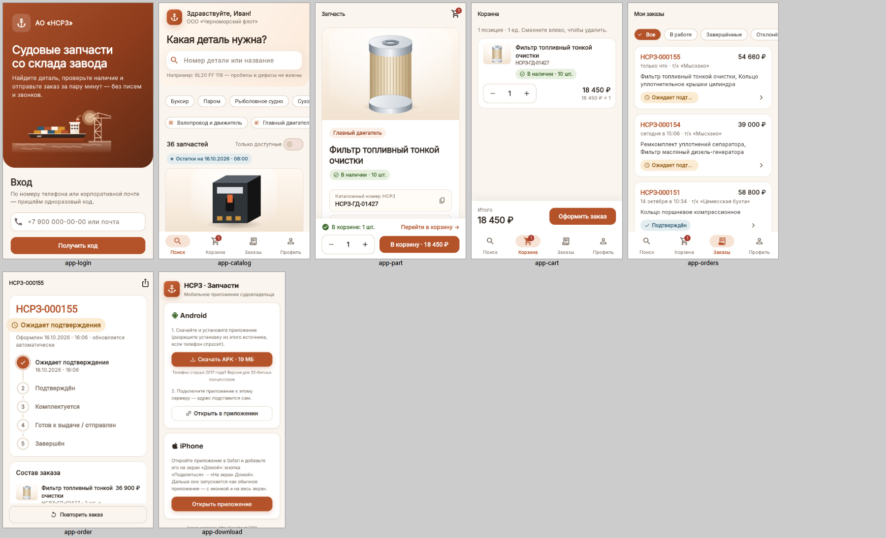
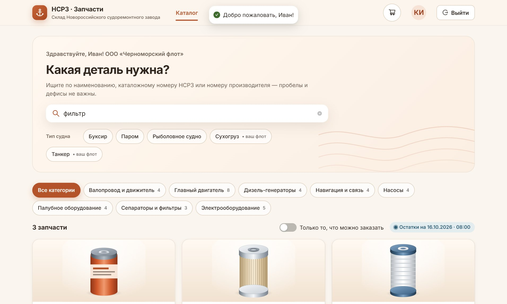
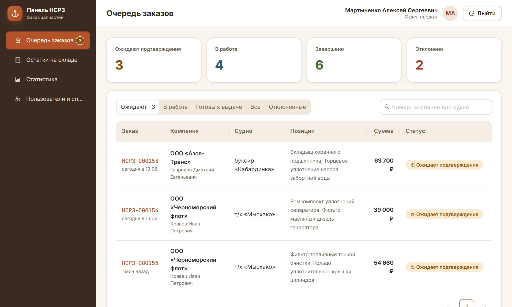
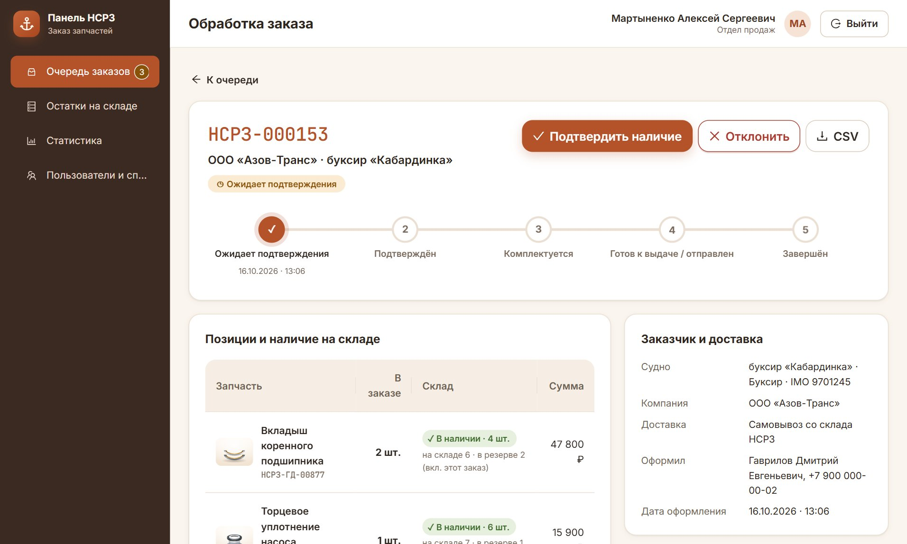
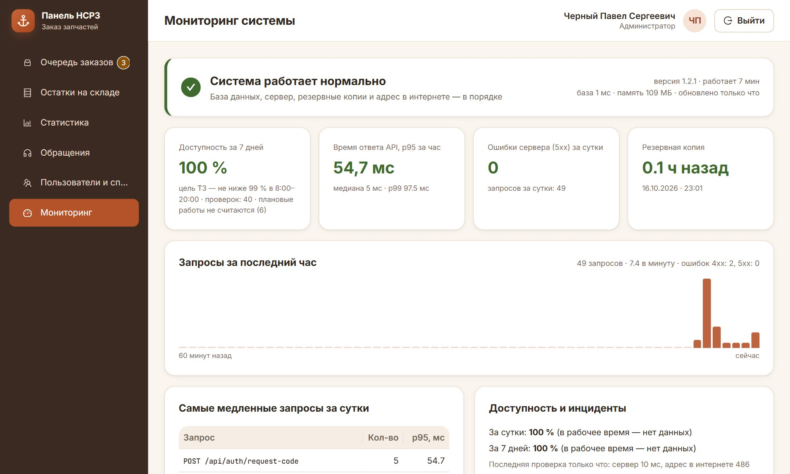

# НСРЗ · Заказ запчастей

Система заказа судовых запчастей со склада судоремонтного завода: **сервер + сайт + мобильное приложение**, с полным циклом тестирования и релизами.

Судовладелец находит деталь по названию или каталожному номеру, видит реальный остаток и оформляет заказ с телефона. Сотрудники завода подтверждают и комплектуют заказы в веб-панели, ведут остатки и отвечают на обращения.

Учебный проект (МДК 01.03 «Разработка мобильных приложений»), сделан под задачу реального предприятия — АО «Новороссийский судоремонтный завод». Версия 1.2.1, все данные в репозитории демонстрационные.



| Сайт судовладельца | Панель сотрудника |
|---|---|
|  |  |
|  |  |

## Стек

| Часть | Технологии |
|---|---|
| Сервер (API) | NestJS 11, TypeScript, Prisma 6, PostgreSQL 16, JWT + роли, Swagger |
| Сайт и панель | React 18, TypeScript, Ant Design 5, TanStack Query, Motion |
| Мобильное приложение | Flutter (Dart), Riverpod, go_router; APK для Android, веб-версия для iPhone |
| Тестирование | Playwright, Jest + Supertest, k6 |
| CI | GitHub Actions: автотесты сервера и сборки всех частей при каждом коммите |

## Тестирование и качество

Полный отчёт: [docs/Этап 5 - Тестирование и контроль качества.md](docs/Этап%205%20-%20Тестирование%20и%20контроль%20качества.md), протокол: [docs/Протокол тестирования.md](docs/Протокол%20тестирования.md).

| Что | Чем | Итог |
|---|---|---|
| UI-сценарии (E2E) | Playwright, Chromium (Edge) и WebKit (Safari), мобильные вьюпорты | 32 сценария: вход, каталог, заказ, панель, техподдержка — [`qa/e2e`](qa/e2e) |
| API и бизнес-правила | Jest + Supertest на отдельной тестовой базе | более 110 тестов, из них 30 на безопасность — [`backend/test`](backend/test) |
| Нагрузка | k6: load, stress, spike, capacity, race | предел ~750 запросов/с; при одновременных заказах последней детали остаток не уходит в минус — [`qa/load`](qa/load) |
| Безопасность | ревью по OWASP Top 10, скрипты атак на стенде, `npm audit` | найдено и закрыто 10 уязвимостей и дефектов — [`qa/security`](qa/security) |
| После релиза | дымовой тест рабочего сервера | 19 проверок после каждой выкатки — [`qa/smoke`](qa/smoke) |

Всего в реестре 13 дефектов, все закрыты; ещё 8 рисков приняты с обоснованием. Примеры найденного:

- подмена заголовка `X-Forwarded-For` позволяла обойти ограничение частоты запросов;
- одновременные попытки ввода кода проверялись сверх лимита в 5 попыток;
- CSV-инъекция в экспорте заказа;
- фильтр категории сбрасывался, если выбрать его в первые 0,3 с после ввода в поиск.

Тесты запускаются на отдельном QA-стенде со своей базой, рабочие данные не трогаются.

## Ключевые правила (проверены автотестами)

- **Резерв.** Заказ сразу резервирует детали: свободный остаток = на складе − в резерве.
- **Повторы.** Двойное нажатие, повтор после обрыва связи и копия ожидающего заказа не создают второй заказ (idempotency key + advisory lock).
- **Одновременность.** Если двое заказывают последнюю единицу одновременно, её получает один.
- **Изоляция.** Судовладелец видит только заказы своей компании.
- **Статусы.** Ожидает подтверждения → подтверждён → комплектуется → готов к выдаче → завершён (или отклонён с причиной); перескочить шаг нельзя.
- **Вход.** Одноразовый код по SMS или почте: не больше 5 попыток, повторный код не чаще раза в 30 с.
- **Без связи.** Приложение показывает сохранённый каталог с отметкой времени.

## Запуск локально

Нужны Node.js 20+ и PostgreSQL 16 (или встроенный `npm run db:start`), для приложения — Flutter.

```bash
cd backend && cp .env.example .env  # заполнить DATABASE_URL и JWT_SECRET
cd backend && npm install && npm run db:start   # PostgreSQL в отдельном окне
cd backend && npm run start:dev                 # http://localhost:3000, Swagger — /api/docs
cd web && npm install && npm run dev            # http://localhost:5173
cd mobile && flutter run -d chrome
```

Тесты:

```bash
cd backend && npm test          # API, база nsrz_test
cd qa && npm install && npm run stand   # QA-стенд (порт 3100, база nsrz_qa), в отдельном окне
cd qa && npx playwright test
cd mobile && flutter test
```

В демо-режиме (`AUTH_DEV_CODES=true`) код входа показывается на экране. Демо-аккаунты, сценарий показа и запуск на домашнем ПК с туннелем: [docs/Запуск и демо.md](docs/Запуск%20и%20демо.md).

## Структура

```
backend/   сервер NestJS: модули auth, catalog, cart, orders, stock, support, monitoring, backup
web/       сайт судовладельца и панель сотрудников (/panel)
mobile/    приложение Flutter
qa/        E2E (Playwright), нагрузка (k6), безопасность, дымовой тест, генерация документов
scripts/   запуск, выкатка (deploy.ps1), сборка APK, сторож доступности
docs/      отчёт о тестировании, протокол, инструкция по запуску
```

История версий: [CHANGELOG.md](CHANGELOG.md), релизы отмечены метками `v1.0.0` … `v1.2.1`.

## Автор

Павел Черный, студент по специальности «Информационные системы и программирование».
Проект сделан вместе с ИИ-ассистентом Claude Code (отмечен соавтором в коммитах): я ставил задачи, проверял результат и разбирал решения.
